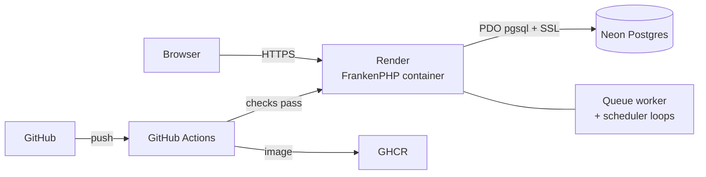

# EventPass

[](https://github.com/saad125862/eventpass/actions/workflows/ci.yml)
[](https://github.com/saad125862/eventpass/actions/workflows/deploy-verify.yml)


**Event ticketing with concurrency-safe booking, instant QR passes and a live check-in scanner**, deployed through a fully automated CI/CD pipeline on free-tier infrastructure.

**Live demo:** https://eventpass-36j5.onrender.com
(free tier: the first request after idle can take ~50 s to wake up)

| Role | Email | Password |
|---|---|---|
| Attendee | `attendee@eventpass.test` | `eventpass-demo` |
| Organizer | `organizer@eventpass.test` | `eventpass-demo` |

Payments run in **test mode**. Use card `4242 4242 4242 4242` (any future date and CVC) to succeed, or `4000 0000 0000 0002` to see a decline. No real money moves.

## What it does

- **Attendees** browse and filter events, pick ticket tiers, hold seats for 10 minutes, pay, and get QR tickets instantly (on screen, as a PDF, and by email).
- **Organizers** create events with multiple ticket tiers, publish them, watch sales on a dashboard, export attendees as CSV, and **scan tickets at the door with a phone camera**.
- **Admins** manage roles and moderate events.

## The interesting engineering

| Problem | Solution |
|---|---|
| Two people buy the last ticket | Bookings run in a DB transaction that **locks the ticket-type rows** (`SELECT ... FOR UPDATE`, in id order) before counting stock. A CI test launches **50 parallel processes against PostgreSQL for 10 tickets and asserts exactly 10 succeed.** |
| Double clicks / retries | **Idempotency keys** (unique per user) return the same order; webhook and payment confirmation are idempotent too. |
| Abandoned carts hogging stock | Pending orders hold seats for 10 minutes. Capacity is computed from *paid + unexpired holds*, so seats free up the instant a hold lapses, even before the scheduler runs. |
| Client-side price tampering | Prices and totals are always read from the database. |
| A ticket scanned twice | Check-in is one atomic `UPDATE ... WHERE status = 'valid'`; only one scan can win, even from two phones at once. |
| Forged payment callbacks | `/webhooks/payments` requires an **HMAC-SHA256 signature** and uses constant-time comparison. |
| CSV injection | Exported cells starting with `= + - @` are neutralised. |

## Architecture



A single free Render container runs the web server, a queue worker (emails) and a scheduler (releases expired holds, sends reminders), because the free tier has no background workers or cron. State lives in Neon.

## CI/CD pipeline

```
push / PR
  ├─ quality      Pint · Larastan · composer audit · tests with a 80% coverage gate
  ├─ concurrency  full suite on a PostgreSQL service (50 racing buyers)
  ├─ docker       build · Trivy scan · smoke test with ALL Linux capabilities dropped
  └─ publish      immutable :sha + :latest image to GHCR            (main only)

Render deploys the commit ONLY after the checks above pass (autoDeployTrigger: checksPass)
  └─ deploy-verify  polls /health until the live version == the commit SHA, then smoke-tests pages
```

- **Zero-downtime and safe:** Render keeps the previous release serving until the new one passes `/health`, and migrations run on boot of the new instance.
- **Traceable:** `/health` reports the deployed commit SHA.
- **Rollback:** redeploy a previous commit from the Render dashboard (or pull a previous `:sha` image from GHCR).
- **Supply chain:** Dependabot (composer, npm, Actions, Docker), `composer audit`, Trivy.

## Run it locally (only Docker is required)

```powershell
docker compose up -d                                  # app on http://localhost:8000 + Postgres
docker compose run --rm app composer install
docker compose run --rm app php artisan migrate
docker compose run --rm app php artisan eventpass:seed-demo   # demo accounts, events and sales
npm install; npm run build                            # frontend assets
```

Tests:

```powershell
# fast (in-memory SQLite)
docker compose run --rm -e DB_CONNECTION=sqlite -e DB_DATABASE=:memory: app php artisan test
# full, including the concurrency test (needs a separate DB so dev data is untouched)
docker compose exec db psql -U eventpass -d postgres -c "create database eventpass_test"
docker compose run --rm -e DB_DATABASE=eventpass_test app php artisan test
```

## Deploy your own (all free)

1. **Neon:** create a project and copy the connection string.
2. **Render:** *New → Blueprint* and pick this repo. Fill in `APP_KEY`, `APP_URL` and `DB_URL`.
3. Optional: UptimeRobot on `/health` keeps the free instance warm; set `MAIL_MAILER=smtp` (and `MAIL_*`) for real email.

## Stack

Laravel 13 · PHP 8.4 · PostgreSQL 17 · Tailwind CSS 4 · Alpine.js · Motion · FrankenPHP · Docker · GitHub Actions · Render · Neon · bacon-qr-code · dompdf

## Project layout

```
app/Services      BookingService (locking), PaymentService, CheckInService, QrCodeService
app/Http          controllers (public, organizer, admin), role middleware, security headers
tests/Feature     auth, roles, booking, payments, tickets, check-in, concurrency
.github           CI, deploy verification, Dependabot
docker/, Dockerfile, docker-compose.yml, render.yaml
```
